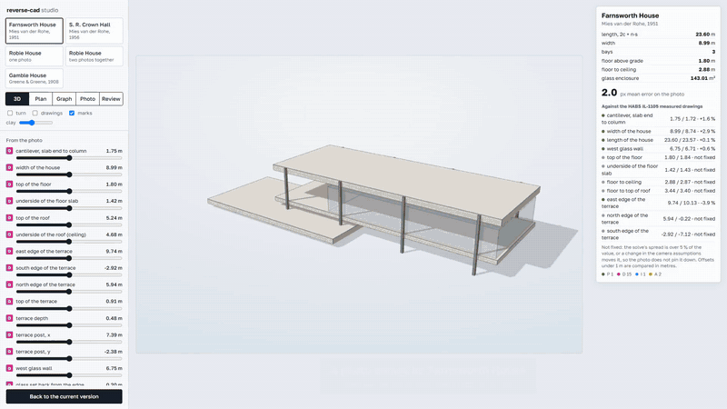
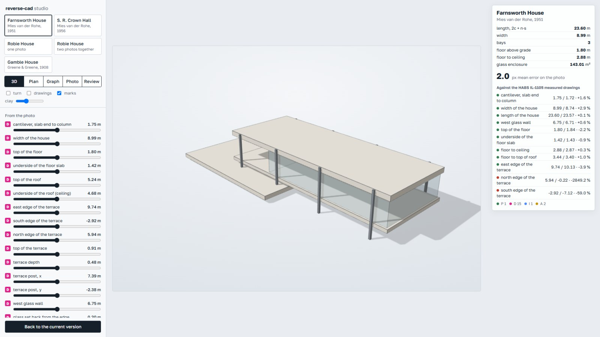
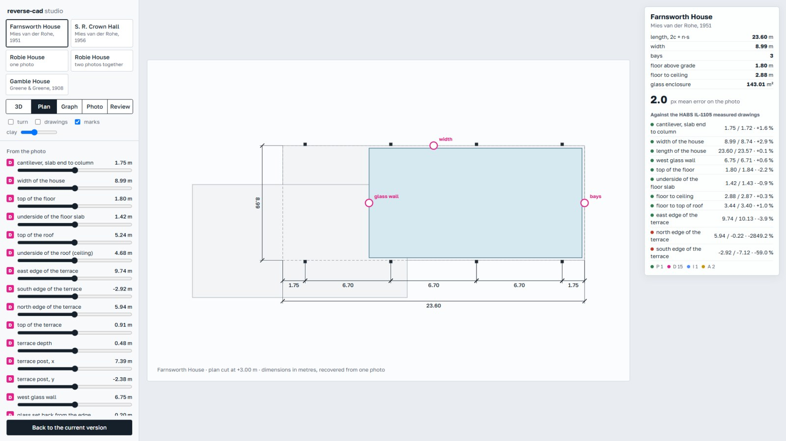
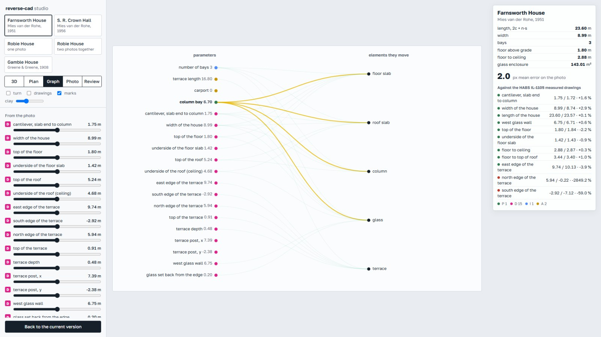
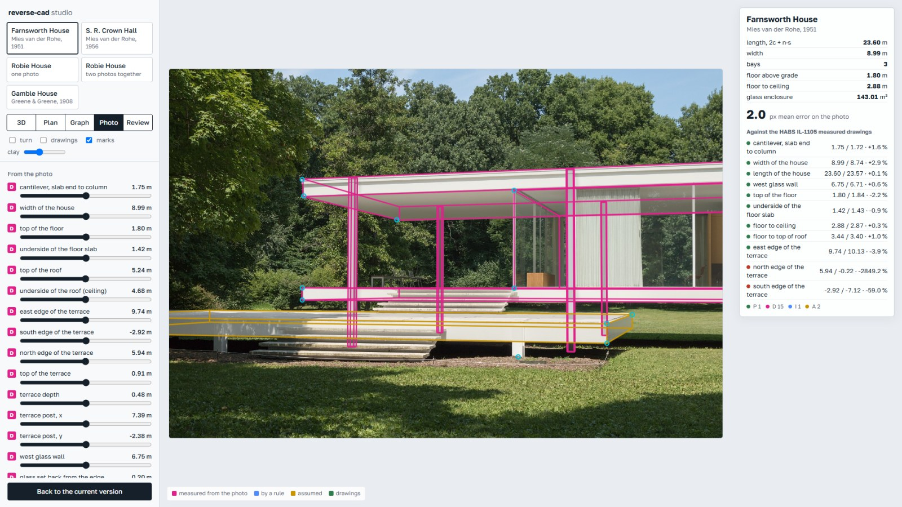
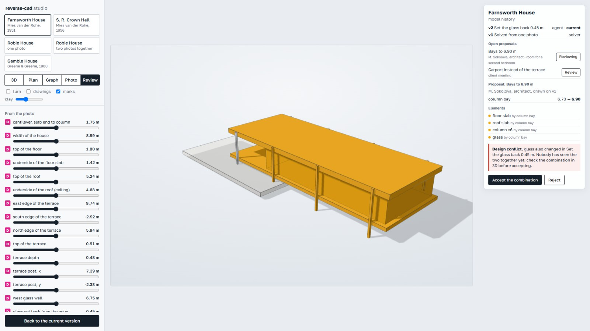
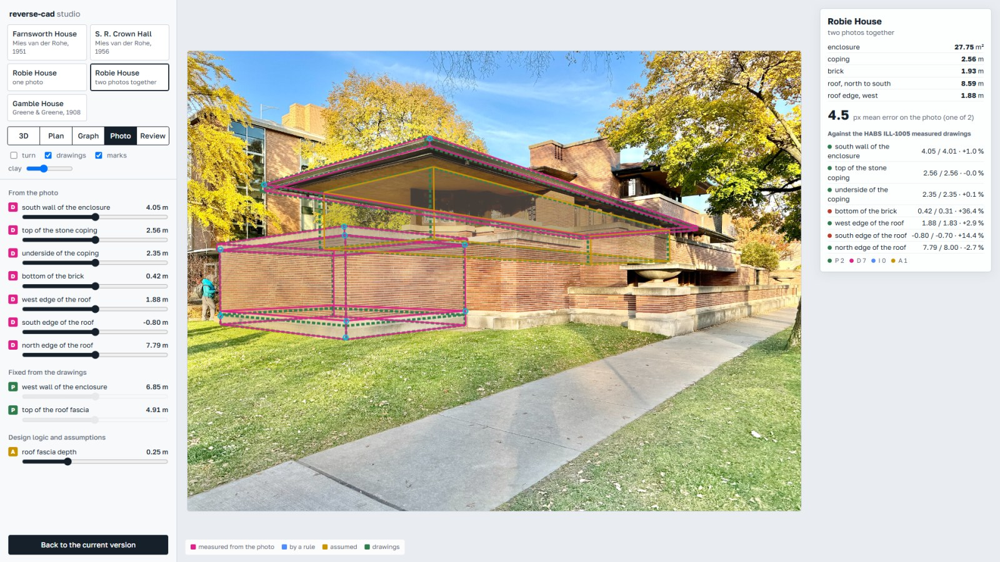

# reverse-cad

Recover a building's camera and parametric model from ordinary photos, and
prove the model against measured drawings.



Videos: [30 s teaser](media/teaser.mp4) · [studio walkthrough, 2 min](media/studio.mp4) · [results walkthrough, 65 s](media/screencast.mp4)

Every number in a model says where it came from: **P** read off a drawing or a
published dimension, **D** measured from a photo, **I** inferred by a design
rule, **A** assumed. A model is done when it lands on the photo from the
recovered camera and its D and I values agree with sources the solve never saw.

## What is here

- **Agent skills** (`skills/`): `reverse-cad` runs the whole job, `reverse-photo`
  solves photos, `reverse-plan` reads measured drawings. Plain `SKILL.md` files
  for Claude Code or any agent that loads skills.
- **A camera and parameter solver** (`tools/solve.py`, `tools/solve_multi.py`):
  marks on the photo tied to 3D expressions over named parameters; camera and
  parameters solved together, from one photo or several at once, with
  bootstrap spread, hold-out and a sweep over camera assumptions.
- **Four cases** (`cases/`) checked against Historic American Buildings Survey
  drawings, with the drawings and photos in `sources/` and `photos/`.
- **A studio** (`studio/index.html`): each solved building as a 3D parametric
  model (see below).
- **A demo page** (`demo/index.html`): move a parameter and watch the model leave
  the photo; hover one to see which marks measure it.
- **Rhino output**: a generator per case, the `.3dm` files, and a viewport
  capture aligned to the photo pixel for pixel.

## Studio

Open `studio/index.html` in a browser (three.js loads from a CDN).

| | |
|---|---|
|  |  |
| **Model**: every element is a formula over named parameters; sliders are graded P/D/I/A, design rules such as the number of bays can be changed | **Plan**: dimensions in metres, recovered from the photo; drag a grip and the plan, the 3D model and the checks follow |
|  |  |
| **Graph**: which parameter moves which element, found by perturbing each one | **Photo**: the camera flies back to where the photographer stood and the model lands on the photo; the panel shows the error in pixels and every check against the drawings |
|  |  |
| **Review**: the model's history and proposed changes from colleagues or agents, a 3D diff (moved amber, added green, removed red) and design conflicts in plain words, with Accept and Reject. No git vocabulary needed | **Robie House**: one photo fits itself and misses the drawings; two photos solved together land on them |

The review screen is the interface side of [paramgraph](https://github.com/vibecading/paramgraph),
which does the same diff and merge in the terminal and in CI.

## Results

From [BENCH.md](BENCH.md), generated by `tools/bench.py`:

| building | photos | within 5 % of the drawings | worst |
|---|---|---|---|
| Farnsworth House (Mies, 1951) | two, solved together | 9 of 9 | 4.1 % |
| Robie House (Wright, 1910) | one iPhone photo | 0 of 3 walls | 18 % |
| Robie House | two, solved together | 6 of 7 | 5.4 % |
| Gamble House (Greene & Greene, 1908) | two, solved together | 3 of 10 | 14.5 % |
| S. R. Crown Hall (Mies, 1956) | one | column bay −1.0 %, ceiling +0.1 % against published figures | |

The Robie House rows are the main lesson. One photo fitted itself to 2.5 px,
its hold-out and camera sweep were quiet, and it was 11–18 % off the drawings.
Only a second photo caught it; solved together the two came within 0.1–1 %.
Gamble House shows the current limit: with layered trim and pitched roofs,
deciding which edge a mark refers to matters more than the solver.

## Quick start

Python 3.10+ with `numpy`, `scipy` and `opencv-python`. Run from the repository
root.

```
# open in a browser (the studio loads three.js from a CDN)
studio/index.html
demo/index.html

# solve one photo, with bootstrap spread and hold-out
python -I tools/solve.py cases/farnsworth/spec_9970.json --boot 100 --holdout

# solve two photos of one building together
python -I tools/solve_multi.py cases/robie/spec_w1.json cases/robie/spec_w2.json --boot 30

# what each parameter depends on, before solving
python -I tools/dag.py cases/robie/spec_w1.json

# the benchmark table and the synthetic tests
python -I tools/bench.py
python -I -m pytest tests -q
```

A spec is JSON: parameters (free or fixed, with notes), the camera's starting
guess, point and line marks with their 3D expressions, and reference values
kept apart as `truth`. See the docstring of `tools/solve.py` and the specs in
`cases/`.

To use the skills, copy `skills/*` into your agent's skills folder (for Claude
Code, `.claude/skills/` in a project or `~/.claude/skills/`).

## Models as text

`tools/to_pg.py` writes a solve as a plain-text parameter graph for
[paramgraph](https://github.com/vibecading/paramgraph): parameters with their
grades, rules, boxes and the drawing values as checks. In git, a change to the
model then reads as a design diff, and merges stop when two branches change
things one element depends on. `docs/git-for-bim.md` is the design note for
reviewing changes to shared building models this way.

## Limits

- Marks are read by hand on zoomed crops (`tools/grid.py`), with edge
  detection to number and refine them (`tools/segments.py`, `tools/snap.py`).
  This is the slowest and most error-prone step.
- Geometry is boxes, lines and gables; no curves.
- One photo gives proportions; scale comes from one known dimension per case.
- Reference values for Gamble House are from the 1908 design drawings, not a
  survey of the built house.

## Credits and licence

Code and documentation: MIT, see [LICENSE](LICENSE). Photos keep their own
licences, listed with their authors in [photos/CREDITS.md](photos/CREDITS.md).
The HABS drawings are public domain; sources for each building are in
`sources/<building>/SOURCES.md`.

Part of [vibecading](https://github.com/vibecading/vibecading), an open lab for
AI-native tools in architecture, 3D and games.
